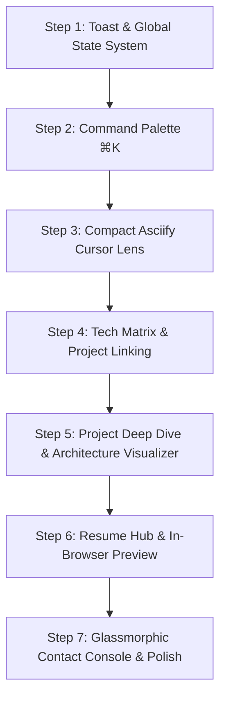

# Portfolio Evolution Plan — Jaiivant Arvind

## 📌 Overview & Goals
- **Objective:** Transform the portfolio into an elite, cutting-edge, dynamic showcase reflecting Jaiivant's unique engineering profile (Full Stack, Systems / Low-Level Assembly, Blockchain & Web3, AI/Vision).
- **Aesthetic Tone:** Luxury Dark Editorial (`#0f0f0f` base, `#c5a35d` champagne gold accent, subtle borders `#262626`, typography with Inter + Playfair Display, smooth Framer Motion micro-animations).
- **Current Stack:** React 19, Vite, TypeScript, Tailwind CSS v4, Framer Motion, Spline 3D, Lucide React.
- **Workflow:** Ideas are discussed collaboratively; approved ideas are added in detail below.

---

## 🚀 Approved Features & Technical Specifications

### Feature 1: Interactive Command Palette (`⌘K` / `Ctrl+K`) — ✅ *Built & Ready for Testing*
* **Objective:** Give recruiters and developers instant keyboard-driven navigation, section jumps, and terminal-like quick actions.
* **Component Location:** `src/components/CommandPalette.tsx`
* **Trigger:**
  - Keyboard listener: `Ctrl+K` (Windows/Linux) and `Meta+K` (Mac), plus `Escape` to close.
  - UI Button: A sleek button in the Navbar (`⌘K`) and a subtle floating indicator.
* **UI/UX Design:**
  - Backdrop blur overlay (`backdrop-blur-md bg-black/70`).
  - Centered floating dialog styled in elevated dark surface (`bg-surface-2 border border-border/80 shadow-2xl`).
  - Search input with active gold accent glow and clear icon.
  - Grouped results with keyboard shortcuts hint badges (`↑` `↓` `↵`).
* **Available Actions & Groups:**
  1. **Navigation:** Jump to Hero, Projects, Tech Matrix, Experience, Education, Contact.
  2. **Projects Quick-Launch:** Directly launch project deep-dive modals (TradeGate, SupplyTrace, TamilVision, AI Resume Analyzer, Mentora).
  3. **Actions & Links:**
     - Open Resume Hub.
     - Copy Email to Clipboard (with toast trigger).
     - Open GitHub / LinkedIn in new tab.
* **State & Logic:**
  - Context/state hook for global toggle (`isOpen`, `setIsOpen`).
  - Fuzzy search query filtering over registered action items.
  - Active item index tracking with keyboard arrow navigation.

---

### Feature 2: Interactive "Project Deep Dive" Modal & Architecture Visualizer — ✅ *Built & Ready for Testing*
* **Objective:** Replace simple bullet lists with an immersive, high-signal project breakdown showcasing real engineering complexity (DOSBox assembly patchers, smart contract state machines, computer vision pipelines).
* **Component Location:** `src/components/ProjectModal.tsx` & `src/components/ArchitectureVisualizer.tsx`
* **Trigger:** Clicking a "Deep Dive / Architecture" button or clicking on a project row in `Projects.tsx`.
* **Key Capabilities:**
  - **Tabs / Sections in Modal:**
    1. **Overview & High-Level Metrics:** Problem statement, impact, tech stack badges.
    2. **Interactive System Architecture Flow:** Visual step-by-step pipeline diagram built with interactive nodes:
       - **TradeGate Flow:** Web Client (React) ➔ In-Memory Binary Patcher (Python) ➔ Headless DOSBox (8086 MASM Assembly) ➔ Gemini AI Live Tariff Fallback.
       - **SupplyTrace Flow:** Next.js Frontend ➔ The Graph Subgraph Indexer ➔ Sepolia Smart Contract (UUPS ERC-1155) ➔ Pinata IPFS & Gnosis Safe Governance.
       - **TamilVision Flow:** Input Image ➔ 12-Step OpenCV Pipeline (Otsu & Resampling) ➔ Grayscale Weight Adapter ➔ MobileNetV3-Small Classifier.
    3. **Key Engineering Breakthroughs:** Deep technical snippets (e.g., 32-bit math assembly division overflow workaround, UUPS proxy security model).
    4. **Direct Action Links:** Live Demo, Source Code Repo, Video/Interactive Simulation.
* **Data Model Extension:**
  - Extend `Project` interface in `src/data/resume.ts` to include `architectureNodes`, `metrics`, `challenges`, and `demoUrl`.

---

### Feature 4: Interactive Tech Matrix & Cross-Project Skill Graph — ✅ *Built & Ready for Testing*
* **Objective:** Elevate the tech stack section from static tags to a dynamic exploration tool showing how skills connect directly to delivered projects.
* **Component Location:** `src/components/TechMatrix.tsx` & `src/data/techMatrixData.ts`
* **Key Capabilities:**
  - **Domain Filter Tabs:**
    - `All Disciplines`, `Systems & Low-Level`, `Blockchain & Web3`, `AI & Machine Learning`, `Full Stack & Cloud` with live item counters.
  - **Interactive Cross-Referencing & Skill Inspector:**
    - Clicking any skill card reveals its architectural implementation note and connected projects.
    - 1-click project jump chips navigate directly to the engineering case study.
    - Synchronized with `Projects.tsx`: filters matching projects, highlights active badges, and provides an instant "Clear Filter" reset.
  - **Command Palette Integration:**
    - All 24 production technologies searchable via `Ctrl+K` with direct focus action.
  - **Skill Card Details:**
    - Visual category icon, proficiency/context badge (`Architectural`, `Production`, `Core Focus`, `Specialized`), and monospace metadata tags.

---

### Feature 5: Quick Resume Hub with Instant In-Browser Preview & Multiple Formats — ✅ *Built & Ready for Testing*
* **Objective:** Allow recruiters and hiring managers to review a complete, beautifully typeset 1-page resume directly in the browser without losing their place, with instant download options.
* **Component Location:** `src/components/ResumeModal.tsx`
* **Key Capabilities:**
  - **In-Browser Document Preview:**
    - Publication-grade editorial document layout styled with clean typography, structured sections, and print-ready CSS.
  - **Export & Action Options:**
    - `Download PDF` (Direct download of official formatted PDF).
    - `Copy Markdown / Plain Text` (One-click copy for ATS parsers and AI screening prompts).
    - `Print / Save as PDF` (`window.print()` trigger).
  - **Quick Trigger Points:** Accessible from the top Navbar, the Hero section CTA, and the `⌘K` Command Palette.

---

### Feature 6: Glassmorphic Contact & Quick Message Console — ✅ *Built & Ready for Testing*
* **Objective:** Provide a frictionless, ultra-modern contact experience combining an editorial form with terminal aesthetics and instant feedback.
* **Component Location:** `src/components/ContactConsole.tsx` (enhancing `Contact.tsx`)
* **Key Capabilities:**
  - **One-Click Email Copy with Toast Notification:**
    - Clickable email card with custom floating toast notification (`"Copied jaiivant@gmail.com to clipboard!"`).
  - **Interactive Quick Message Form:**
    - Fields: Name, Email, Subject, Message.
    - Live client-side validation with smooth shake/error cues and subtle champagne gold focus states.
    - Form submission state handling (idle, sending, success checkmark animation).
  - **Quick Meeting / Scheduling Link:**
    - Optional direct link for booking a quick coffee chat / technical discussion.
  - **Social Links with Magnetic Hover:**
    - GitHub, LinkedIn, Email buttons with spring physics cursor follow and tooltip badges.

---

### Feature 8: Cursor-Reactive ASCII Lens (`@canvas-ui/asciify-react`) with Compact Radius — ✅ *Built & Ready for Testing*
* **Objective:** Render an interactive, real-time ASCII lens around the user's cursor as they hover over the portfolio, redrawing live DOM elements underneath into glowing ASCII characters while maintaining complete text interactivity and selection.
* **Component Location:** `src/components/canvasui/Asciify.tsx` & `src/components/Hero.tsx`
* **Package/Registry Source:** `npx shadcn@latest add @canvas-ui/asciify-react` (Canvas UI HTML-in-Canvas shader).
* **Radius & Visual Tuning (User Requirement: Small / Subtle, Not Too Big):**
  - **Compact Radius:** Configured at `radius: 0.14` (relative to viewport height) rather than the default `0.4`, ensuring a tight, surgical spotlight lens that enhances rather than overwhelms readability.
  - **Edge Softness:** `softness: 0.75` for a gradual, organic feathering into standard typography.
  - **Snappy Follow:** `followSpeed: 4.5` for immediate, low-latency cursor tracking.
  - **Glyph Resolution:** `scale: 1.5`, `spacing: 1`, with `"ascii"`, `"binary"`, and `"blocks"` charsets supported.
  - **Optical Accents:** `glow: 0.65`, `aberration: 0.3`, matching the dark luxury editorial palette.
* **Placement & Scope:**
  - Applied cleanly over the Hero section headline and bio.
  - Interactive status pill on the Hero section allows toggling ASCII Lens and cycling charsets (`ASCII` / `Binary` / `Blocks`).
  - Includes quick toggle and radius adjustment options in the `⌘K` Command Palette.

---

## 💡 Ideas in Backlog / Under Discussion
- **Idea 3: Embedded "8086 / Cyber Console" Mini-Playground (Interactive Easter Egg)**
  - A retro-modern collapsible terminal widget where visitors can simulate a trade duty calculation via TradeGate logic, inspect an ERC-1155 Sepolia block, or run Tamil character OCR pre-processing live.
- **Scratched: Feature 7 (ASCII Sweep Navbar Transition)**
  - Removed per user preference in favor of direct, instant smooth-scrolling navigation.

---

## 🛠️ Step-by-Step Implementation Sequence

1. **Phase 1: Foundation & Global Interactive Effects**
   - [x] Implement Toast notification system (`ToastContext` or lightweight toast utility).
   - [x] Implement `CommandPalette.tsx` with keyboard hooks and quick search.
   - [x] Configure and integrate `Asciify.tsx` with compact radius (`radius: 0.14`) over hero/key showcase zones.
2. **Phase 2: Project Deep Dive & Tech Matrix**
   - [x] Build `TechMatrix.tsx` with domain tabs, interactive skill graph, and bi-directional project filtering.
   - [x] Create `src/data/projectDetails.ts` with deep architecture flows, subsystems, and code snippets.
   - [x] Build `ProjectModal.tsx` and `ArchitectureVisualizer.tsx` with interactive diagram nodes and continuous project cycling (Built & Ready for Testing).
3. **Phase 3: Resume Hub & Contact Console**
   - [x] Build `ResumeModal.tsx` with styled document preview, official PDF download, and ATS plain text copy (Built & Ready for Testing).
   - [x] Upgrade `Contact.tsx` into `ContactConsole.tsx` with toast feedback and form animations (Built & Ready for Testing).
4. **Phase 4: Integration & Quality Assurance**
   - [x] Connect all navigation and keyboard shortcuts throughout `App.tsx`, `Navbar.tsx`, and `Footer.tsx` (Completed).
   - [x] Resolve all ESLint and React 19 warnings/errors, achieve 0-error TypeScript build, and verify production bundle (Completed).
